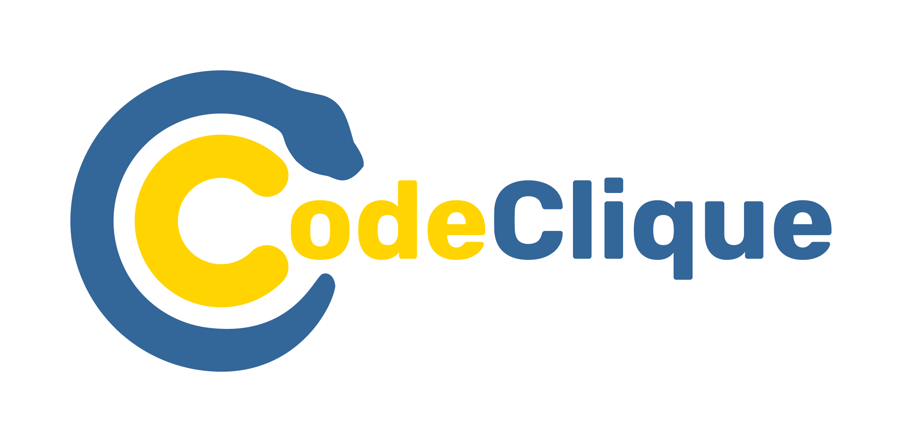
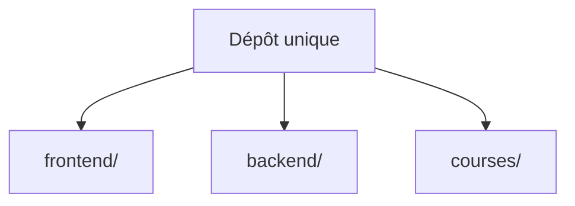

<p align="center">
    
</p>

[Licence MIT](LICENSE)

## 🏗️ Structure du Projet

Ce projet regroupe le frontend, le backend, les cours et la configuration Docker dans un **dépôt Git unique**. Les dossiers `frontend`, `backend` et `courses` contiennent directement le code et ne sont plus des sous-modules.

Le code provient de [CodeClique](https://github.com/CodeClique-RobertDoisneau/CodeClique). Les licences d'origine sont conservées à la racine et dans chaque dossier.



- **CodeClique** : Contient la configuration Docker et l'orchestration.
- **frontend** : Le code du frontend, écrit avec Angular.
- **backend** : Le code du backend, écrit avec Django.
- **courses** : Les cours, écrits en Markdown.

## 🚀 Démarrage

### Développement

1. **Prérequis** : Docker et Docker Compose.
2. **Récupérer le projet** : utilisez le dossier local ou clonez le dépôt :
    ```bash
    git clone https://github.com/gris-chat/CodeClique.git
    cd CodeClique
    ```
    Toutes les commandes suivantes s'exécutent à la racine du projet. Aucun téléchargement de sous-module n'est nécessaire.
3. **Lancer les conteneurs** :
    ```bash
    docker compose watch
    ```
4. **Arrêter les conteneurs** : `docker compose down`

### Production

Pour mettre en production, exécutez les commandes suivantes. Voici ce qu'elles font étape par étape :

1. **Récupération du code** :
    ```bash
    git clone https://github.com/gris-chat/CodeClique.git
    cd CodeClique
    ```
    Un seul clone récupère le frontend, le backend et les cours.

2. **Construire les images** :
    ```bash
    docker compose -f compose.yaml -f compose.prod.yaml build --no-cache
    ```
    Combine la configuration de base (`compose.yaml`) avec la surcharge de production (`compose.prod.yaml`) et force une reconstruction complète des images pour garantir que les dernières dépendances sont installées.

3. **Lancer les conteneurs** :
    ```bash
    docker compose -f compose.yaml -f compose.prod.yaml up -d
    ```
    Lance les services en arrière-plan (`-d`).
4. **Arrêter les conteneurs** : 
    ```bash
    docker compose -f compose.yaml -f compose.prod.yaml down
    ```

## 🤝 Guide de Contribution

Nous utilisons un modèle de branches strict pour garder l'historique propre et lisible.

### Stratégie de Branches

*   **`main`** : Branche de production, stable. Ne jamais commit directement dessus.
*   **`dev`** : Branche d'intégration principale. **Toutes les Pull Requests doivent viser `dev`.**
*   **Branches de travail** : Doivent être tirées depuis `dev` et suivre la convention de nommage.

### Politique de Commit et de Nommage

Nous suivons les spécifications suivantes pour le nommage des commit et des branches:
- **[Conventional Commits](https://www.conventionalcommits.org/)**
- **[Conventional Branches](https://conventional-branch.github.io/)**

### Politique de Merge

1. **Cible** : Les PRs doivent être fusionnées dans **`dev`**.
2. **Méthode de Merge** : Dans l'optique d'une meilleure compréhension de l'historique pour des futurs contributeurs, nous préférons faire des **Merge Commit** (sans fast-forward). Les **Squash and Merge** commits sont aussi autorisés mais moins idéaux.
3. **Validation** : Pas de CI/CD automatique pour le moment. Une revue de code est obligatoire avant tout merge.
